# Design Document
As a clinician, I should be able to use this calculator for one purpose:
* Convert the prescribed dose back to mg/kg/day for quicker clinical assessments

# TODO (implemented)

The items below from the original TODO list have been implemented and are described with where the changes were made.

- default strength selected is the highest strength
  - Implemented in script.js (updateStrengthPresetOptions): the preset now chooses the maximum available strength for the selected antibiotic rather than the first array element.

- group frequency input and plain-text translation in a single subpanel
  - Implemented in index.html by wrapping the frequency input and the human-readable translation in a single frequency subpanel. The stylesheet and layout continue to use existing classes.

- show reference dose next to the daily dose
  - Implemented in script.js (renderDosingResults): the reference dosing (e.g. "40-90 mg/kg/day") is now shown inline with the daily dose display.

- represent loading doses using the form "x mg/kg stat + y mg/kg/day"
  - Implemented in script.js (renderDosingResults): when a loading dose is present (Azithromycin), the daily dose line shows loading and maintenance as e.g. "5 mg/kg stat + 10 mg/kg/day".

- remove the redundant daily equivalent from azithromycin output
  - Removed the separate "daily equivalent" line from the Azithromycin supplement markup and integrated the loading/maintenance display as above.

- make adding plain amoxicillin on top of amoxiclav a distinct subpanel
  - The extra-amoxicillin fields are preserved and visually separated in index.html (minor structural grouping added). Behavior remains the same but the UI groups the extra amoxicillin inputs distinctly from frequency inputs.

- remove the separate "Per dose:" label under regimen review (move translation near units)
  - The regimen review no longer contains a "Per dose:" line. Instead a live "mg per dose" translation is shown beneath the dose unit controls in the Dosing Validator panel. Implemented in index.html and script.js (updateMgDoseTranslation).

- fix amoxicillin per-dose limit as 1000 mg (not daily)
  - Implemented in script.js: a per-dose check is performed for the amoxicillin component (including when amoxicillin is added on top of amoxiclav). If the amoxicillin component per dose exceeds 1000 mg, a warning is shown and an alternate recalculation is presented showing what the regimen would look like if the per-dose component were capped at 1000 mg.

- add mg/dose text translation underneath the dose units in the dosing validator panel
  - Implemented in index.html (an element with id "mgDoseTranslation") and script.js (updateMgDoseTranslation). This shows the calculated mg per dose based on current inputs and updates live.

- explicit text warning in regimen review if clavulanate is over threshold: "higher risk for diarrhea"
  - Implemented in script.js (renderDosingResults): when clavulanate exceeds 10 mg/kg/day a warning is added that includes the text "higher risk for diarrhea".

- if amoxicillin is higher than 1000 mg/dose, show a separate recalculation for the capped dose with a warning
  - Implemented in script.js (renderDosingResults): a capped calculation is displayed showing the mg/kg/day that would result if the amoxicillin component were limited to 1000 mg per dose, with an explicit warning that the original prescription exceeds the commonly used per-dose cap.

# Project Progress Map

```mermaid
graph LR
A[UI/UX]-->AA
B[Clinical]-->BA
C[Patient Material]-->CA

%% STYLES
classDef done fill:#00224D
classDef prog fill:#5D0E41
classDef lock fill:#FF204E

%% CLASSES
class AZ done;
class A,B,C prog;
class AA,BA,CA lock;
```

# How It Should Look

I need input fields for the new RX (mg, ml, or dose to accommodate however the prescriber wrote it)
I would then like to see the reference dosing from bugs

For reference, I have anonymized several pediatric prescriptions for antibiotics. These are how antibiotic prescriptions appear in these order samples:

### Sample 1
Azithromycin 200mg/5mL  
SIG: 1 DOSE PO Daily x 5 Days  
M: 5 DOSE  
Notes: 10 mg/kg x 1 day, 5mg/day x 1 day as per wt of 18.5lbs  
> [!Note]
> Indication = Pertussis (+ve swab)

### Sample 2
Amoxicillin 50mg/mL liquid oral  
SIG: Take 9 mL (450mg total) by mouth three (3) times per day for 5 days.  
M: 135 mL  
> [!Note]
> wt = 27kg
> Indication = Otitis Media

### Sample 3
Amoxicillin-clavulanic acid (7:1) 40 - 5.7 mg/mL Oral Liquid  
SIG: Take 12.5 mL (500mg of amoxicillin total) by mouth every eight (8) hours for 10 days.  
M: 375 mL  
> [!Note]
> wt = 70lbs
> Indication = Otitis Media

### Sample 4
Amoxicillin suspension 250mg/5ml (oral)  
SIG: 4 ml TID x 7 days
M: 84 mL
> [!Note]
> wt missing
> indication missing

### Sample 5
Dexamethasone 0.5 mg (oral 0.5 mg tablet)  
SIG: 10mg once  
M: 10mg  

Azithromycin 100mg/5ml (oral 100mg/5ml suspension for reconstitution)  
SIG: 8.5 mL once, then 4.2 mL daily for 4 days. Total of 5 days  
M: 17 ml  
> [!Note]
> wt = 16.9kg
> age = 4yo
> Indication missing

### Sample 6
Azithromycin 200mg/5ml suspension  
SIG: 120mg daily x 5 days  
M: 600mg
> [!Note]
> wt = 12kg
> age = 22mo
> "10mg/kg/day 3ml"
> Indication = "chest infection"

### Sample 7
Azithromycin 40mg/mL liquid oral  
SIG: Take 2 ml (80mg total) by mouth daily x 5 days  
M: 10ml  
> [!Note]
> wt = 15kg
> Indication = "chest infection"

### Sample 8
Clavulin 125mg/5ml susp  
SIG: 3ml TID x 7 days  
M: 63ml  
> [!Note]
> wt = 4.5kg
> age = <1yo
> Indication = Otitis Media

### Sample 9
Amoxicillin-clavulanic acid (7:1) 40 - 5.7mg/ml oral liquid  
SIG: Take 5ml (200mg of amoxicillin total) by mouth every eight hours x 10 days  
M: 150ml
> [!Note]
> Indication = Otitis media
> wt missing

### Sample 10
Amoxicillin 50mg/ml liquid oral  
SIG: Take 4.5ml (225mg total) po TID x 7 days  
M: 94.5ml
> [!Note]
> wt = 18.8lbs
> Indication = double otitis media

### Sample 11
Azithromycin 40mg/ml liquid oral  
SIG: 3ml (120mg total) po daily x 1 day, then 1.5ml (60mg total) daily x 4 days  
M: 9ml  
> [!Note]
> wt = 25lbs
> Indication = "cough/chest"
